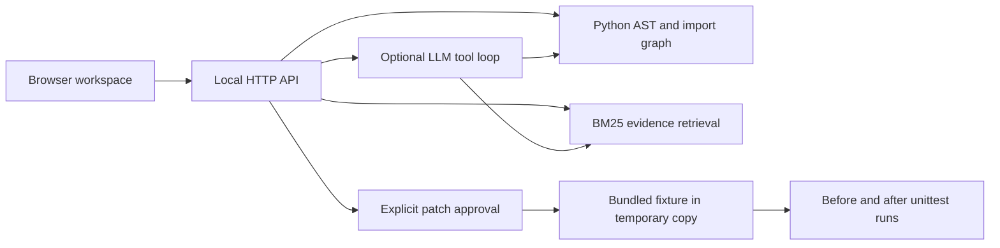

# LegacyLens

**Understand the system. Change it with confidence.**

A software investigation workspace that turns a Python repository into a navigable dependency map, retrieves source evidence, and demonstrates a reviewed repair with real before-and-after tests.

Created by **Mohammed Banabilh**, with AI assistance for implementation, testing and documentation. An independent engineering portfolio project inspired by the difficulty of understanding older business software. It is not affiliated with any employer or software vendor.

[](https://github.com/Mohammed-890/legacylens/actions/workflows/checks.yml)

## Run in 30 seconds

Requires Python 3.11 or later. No third-party runtime packages or API key are needed for evidence mode.

```sh
git clone https://github.com/Mohammed-890/legacylens.git
cd legacylens
python3 -m legacylens.server
```

Open **http://127.0.0.1:8765**. Start with the bundled, entirely synthetic Northstar billing incident, or import a small Python repository using the folder picker.

## What you can actually do

- **Explore the architecture:** an interactive city or graph of files, real static Python import edges, and reverse dependency impact.
- **Inspect source evidence:** exact file names, line ranges, source windows and stable evidence IDs within a project snapshot.
- **Investigate a question:** BM25 source retrieval without a model, or an optional LLM agent that chooses among three read-only evidence tools.
- **Review risk signals:** five Python AST rules for constructed SQL, dynamic execution, mutable defaults, bare exceptions and missing HTTP timeouts.
- **Approve a repair demonstration:** inspect a predefined invoice patch, approve its fingerprint, and run the bundled five-test suite before and after in a temporary copy.
- **Audit results:** inspect tool activity, source citations, recorded evaluations and raw test output. Export the evaluation report or patch.

The demo incident: a customer schema changes from `full_name` to `display_name`, while an invoice consumer still expects the old key. The unmodified fixture has three test errors. The reviewed change makes all five tests pass.

## Live app versus hosted showcase

| Capability | Local Python app | Static hosted showcase |
|---|---|---|
| Architecture and source exploration | Live imported source or bundled fixture | Bundled snapshot |
| Evidence retrieval | BM25 | Browser keyword matching |
| LLM tool calling | Optional, with your provider configuration | Unavailable |
| Repository folder import | Yes; source held in process memory | Unavailable |
| Repair test execution | Real tests on the bundled fixture | Clearly labelled recorded output |
| Evaluation report | Regenerate with the script below | Recorded report |

The hosted showcase is a demonstration of the interface, not a remotely running Python agent. The full application lives in this repository. The Sites preview starts owner-private; it is not a public recruiter link until its owner changes sharing.

## Enable optional AI investigation

Choose a provider and model that support the OpenAI-compatible Chat Completions tool-calling format. Export `LLM_API_KEY`, `LLM_MODEL` and, when needed, `LLM_BASE_URL` in your shell before launching the server. See [.env.example](.env.example); the application does **not** automatically load that file.

```sh
export LLM_MODEL='your-tool-calling-model'
export LLM_BASE_URL='https://your-provider.example/v1'
# Set LLM_API_KEY securely in your environment; never commit it.
python3 -m legacylens.server
```

Then explicitly enable **Use configured LLM** in the investigation view. This sends your question and retrieved source to that provider. Without opt-in, the local evidence engine handles the question. Provider billing and data policies apply. Provider integration is covered by mocked protocol tests; a paid live-provider run has not been verified for this release.

The model can call `search_source`, `read_source`, and `change_impact`. It cannot modify a repository or execute shell commands. Tool iterations are bounded, and final citation IDs must come from retrieved evidence. Citation validity does not prove that the model's interpretation is correct.

## Verification

```sh
python3 -m unittest discover -s tests -v
python3 scripts/evaluate.py
node --check web/app.js
```

The implementation includes **32 automated tests** and **19 reproducible evaluation checks**. These cover retrieval, citations, static rules, imports, input boundaries, mocked agent calls, HTTP protections and the repair fixture. They are a small deterministic suite, **not a benchmark of LLM diagnosis quality**. The evaluation script regenerates the four JSON snapshots in `web/` with actual outputs and timestamps.

GitHub Actions runs verification on Python 3.11, 3.12 and 3.13. Node is only needed for JavaScript syntax checking; it is not needed to run the app.

## Architecture



- **Python standard library:** parsing, retrieval, HTTP, provider calls and test execution.
- **Plain JavaScript, CSS and SVG:** responsive UI, interactive architecture views, source inspector and trace display.
- **No database:** repositories are capped and retained in process memory. Restarting the server clears imported projects.
- **No external frontend assets:** the interface works without a CDN or third-party font.

See [architecture and tradeoffs](docs/ARCHITECTURE.md), [evaluation notes](docs/EVALUATION.md), and the [90-second demo](docs/DEMO.md).

## Boundaries worth knowing

Python imports approximate dependencies; this is not a runtime call graph. Static findings require human review. Large repositories are deliberately unsupported (160 text files and 2 MB of indexed text). Filename filters are not secret detection: review a folder before importing or sending its source to a provider.

The repair is a **maintainer-authored patch for one controlled fixture**, not autonomous repair of arbitrary software. A temporary directory is not a security sandbox. Uploaded code is never executed. The built-in server is intended for local use, not exposure as a multi-user production service.

## Container option

```sh
docker compose up --build
```

The configuration binds the published port to loopback, runs a non-root user with a read-only root filesystem, and provides a temporary filesystem for the fixture tests. Container configuration is supplied; see the release validation notes for what was actually exercised.

## Next engineering milestones

1. Add a labelled, held-out incident dataset and compare model diagnosis against the retrieval-only baseline.
2. Support package-aware import resolution and additional language parsers.
3. Add patch generation only after introducing a hardened isolated execution service, resource limits and reviewed change policies.

MIT licensed. Contributions and issue reports are welcome.
